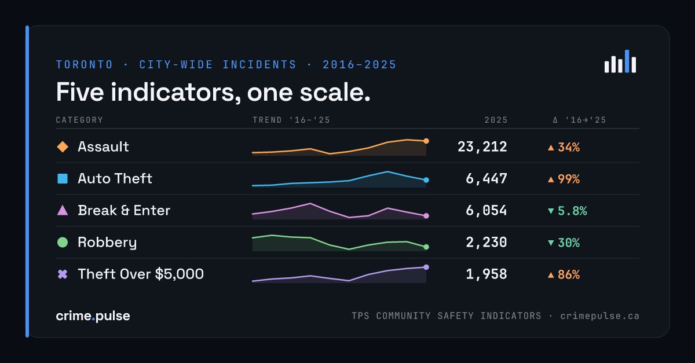

# Toronto Crime Pulse

Static public-awareness dashboard for **Toronto** crime trends. Pick a
neighbourhood and crime types, then read incident counts (rates per 10,000
residents are one toggle away), a chronological feed, and a Leaflet choropleth
of the City’s 158 official neighbourhoods.

**Live site:** [https://crimepulse.ca](https://crimepulse.ca)

[](https://crimepulse.ca)

This is **not** an official Toronto Police Service, City of Toronto, or
Statistics Canada product. Code is [MIT](LICENSE). TPS, City, and Statistics
Canada data keep their own licences — see [NOTICE](NOTICE).

## What’s in the box

- Overview, Compare, About, a neighbourhood index, and one static page per
  neighbourhood (163 pages from `npm run build`)
- Five TPS Community Safety Indicators: assault, auto theft, break & enter,
  robbery, theft over $5,000
- Raw counts by default; per-10K rates on a single toggle
- Hand-rolled SVG/Preact charts (not Chart.js) and a neighbourhood choropleth
  — no incident-level map dots
- Canonical source is Markdown under [`data/crimes/`](data/crimes/), including
  the lat/lng columns from TPS. The build aggregates that into JSON the
  dashboard reads at runtime

## Quick start

Needs **Node.js ≥ 22.12** (see `.nvmrc`) and **Python 3**.

```bash
git clone https://github.com/alexkarasyov/crime-pulse_open-source.git
cd crime-pulse_open-source
npm install
npm run build    # aggregates → OG images → static site in dist/
npm run preview  # serve dist/ locally
```

For day-to-day work:

```bash
npm run dev      # http://127.0.0.1:41690  (also serves /project and /styleguide)
npm test         # Vitest + Python importer tests (run after a production build)
npm run verify   # types, production build, unit/data tests, Chrome QA
```

The aggregate builder uses Python’s standard library. Re-importing the
population XLSX also needs `openpyxl` from [`requirements.txt`](requirements.txt).
Browser QA needs Chrome or Chromium (`CHROME_PATH` if it is not in a standard
location).

## Data and licences

| Source | What it’s used for | Terms |
| --- | --- | --- |
| Toronto Police Service Community Safety Indicators | Incident archive | [Open Government Licence – Toronto](https://open.toronto.ca/open-data-licence/) |
| City of Toronto neighbourhood boundaries | Choropleth geography | Open Government Licence – Toronto |
| Statistics Canada tables (population, CSI, CMA rates) | Rates and context cards | [Statistics Canada Open Licence](https://www.statcan.gc.ca/en/reference/licence) — keep the `Source: Statistics Canada, Table …` lines |

Contains information licensed under the Open Government Licence – Toronto.

Full wording is in [NOTICE](NOTICE). Do not strip lat/lng from the Markdown;
the UI still does not plot incident dots ([ADR-003](project/decisions/003-choropleth-map-not-incident-dots.md)).

## Layout

| Path | What’s there |
| --- | --- |
| [`AGENTS.md`](AGENTS.md) | Entry point for AI agents |
| [`NOTICE`](NOTICE) | Data-licence terms |
| [`data/crimes/`](data/crimes/) | Imported yearly TPS Markdown tables |
| [`docs/`](docs/) | Spec, changelog, test records |
| [`project/`](project/) | Charter, backlog, ADRs |
| [`scripts/`](scripts/) | Importers and the aggregate builder |
| [`src/`](src/) | Astro + Preact app |

## Deploy

`npm run build` emits a static site in `dist/`. Production is
[crimepulse.ca](https://crimepulse.ca) on Cloudflare. Notes for pointing a
fork at your own host are in [`docs/deploy.md`](docs/deploy.md). Override the
canonical origin with `SITE_URL` if you are not building for crimepulse.ca.

## For agents

Start at [AGENTS.md](AGENTS.md). Spec and changelog live in [`docs/`](docs/);
working agreements live in [`project/`](project/).

## Licence

- Software: [MIT](LICENSE) © 2026 Alex Karasyov
- Data: [NOTICE](NOTICE)
